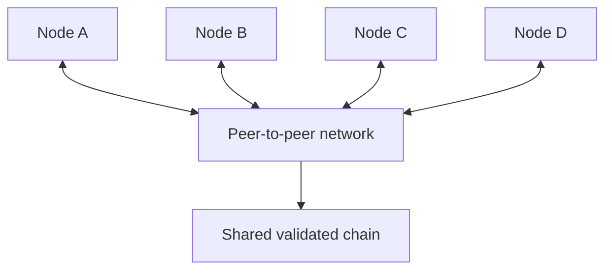
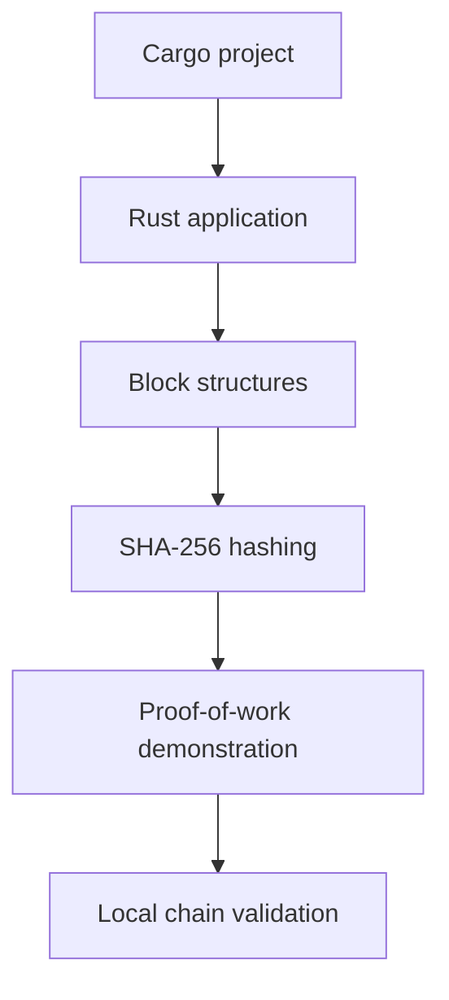

# CHERAKS (CHK)

### An open-source, proof-of-work cryptocurrency experiment.

<p align="center">
  <strong>Building the foundations of a decentralized digital currency.</strong>
</p>

<p align="center">
  <a href="https://github.com/n4dm/cheraks"></a>
  <a href="https://github.com/n4dm/cheraks"></a>
  <a href="https://github.com/n4dm/cheraks"></a>
  <a href="https://github.com/n4dm/cheraks"></a>
</p>

<p align="center">
  <a href="#-overview">Overview</a> ·
  <a href="#-how-it-works">How it works</a> ·
  <a href="#-getting-started">Get started</a> ·
  <a href="#-developers">Developers</a> ·
  <a href="#-roadmap">Roadmap</a>
</p>

---

> **Development notice:** Cheraks is an experimental software project. The current prototype demonstrates basic blockchain concepts, including block hashing and proof-of-work mining. It is not a production-ready cryptocurrency, has no functioning public peer-to-peer network, and should not be used to store or transfer real value.

## ◆ Overview

**Cheraks**, represented by the ticker **CHK**, is an open-source project exploring the development of a Bitcoin-inspired digital currency using Rust.

The long-term objective is to develop a verifiable blockchain with proof-of-work consensus, a transparent issuance policy, independent network nodes, and tools for users and developers.

The project starts with a small educational prototype and aims to evolve through testing, review, and incremental development.

### Project principles

- **Open development** — make the source code available for inspection and contributions.
- **Verifiable rules** — build toward transparent consensus and issuance rules.
- **Decentralization** — work toward a network that independent participants can operate.
- **Security first** — validate transactions and blocks before considering a public launch.
- **Developer friendly** — document the protocol, development environment, and testing process.
- **Testnet before mainnet** — test with coins that have no monetary value before considering a production network.

## ◆ Project information

| Property | Current plan |
|---|---|
| Project name | Cheraks |
| Ticker symbol | CHK |
| Implementation language | Rust |
| Intended consensus | Proof of work |
| Planned maximum supply | 21,000,000 CHK |
| Intended purpose | General-purpose digital currency |
| Current stage | Early prototype |
| Current network | Local demonstration only |
| Public testnet | Not launched |
| Mainnet | Not launched |
| Production wallet | Not available |
| Exchange listings | None announced |
| Official website | Not yet announced |

**Important:** The 21 million CHK figure is a planned monetary policy, not yet an independently verified, production-enforced supply limit. The ticker is a project identifier, not evidence that a transferable currency exists.

## ◆ How Cheraks works

The intended design follows the broad concepts behind proof-of-work blockchains. The current prototype implements only a small subset of these concepts.

### 1. Transactions

In a complete cryptocurrency, a transaction would describe a transfer of value between participants.

A full implementation needs to verify digital signatures, confirm that funds are available, reject duplicate spending, and enforce transaction rules.

**Current status:** A complete transaction and balance system has not been implemented.

### 2. Block creation

A blockchain groups validated transactions into blocks. Each block refers to its predecessor, creating a linked history.

Conceptually:

```text
Genesis Block
     |
     v
  Block #1
     |
     v
  Block #2
     |
     v
  Block #3
     |
     v
    ...
```

Changing an earlier block changes its hash and breaks the link to subsequent blocks unless the chain is rebuilt.

**Current status:** The prototype contains basic block structures and hash-linked blocks.

### 3. Cryptographic hashing

Cheraks currently uses SHA-256 hashing in its Rust prototype.

A hash function maps input data to a fixed-length digest. The digest can be used to identify a block's contents and support proof-of-work calculations.

Illustrative example:

```text
Block data
    |
    v
 SHA-256
    |
    v
Block hash
```

A hash is not an encryption key, digital signature, or proof that a transaction is legitimate.

### 4. Proof-of-work mining

Proof of work requires a miner to search for a block header that satisfies a difficulty target.

In a simplified demonstration, a miner changes a nonce and hashes the block repeatedly until the hash satisfies the configured condition.

```text
        Candidate block
              |
              v
       Calculate hash
              |
              v
      Meets difficulty?
          /       \
        No         Yes
        |           |
   Change nonce   Accept candidate
        |           |
        +-- retry   v
                 New block
```

The prototype uses a simplified leading-zero condition to demonstrate mining. This is not yet a production consensus protocol.

A real network needs a precisely defined target calculation, difficulty adjustment, block validation rules, chain selection, and protection against malformed or adversarial blocks.

### 5. Independent nodes

The long-term objective is for separate computers to run the same protocol and verify the same blockchain.



This is a planned architecture, not a description of a currently operating Cheraks network.

**Current status:** Peer discovery, network transport, block synchronization, and multi-node consensus are not implemented.

## ◆ Architecture

The initial implementation is intentionally small.



The future architecture may add the following components:

| Component | Responsibility | Status |
|---|---|---|
| Block model | Represent blocks and their links | Basic prototype |
| Hashing | Calculate SHA-256 block hashes | Prototype |
| Mining | Search for a simplified proof of work | Prototype |
| Validation | Check basic chain integrity | Basic prototype |
| Transactions | Verify transfers and prevent double spending | Not implemented |
| Digital signatures | Authenticate transaction authorization | Not implemented |
| Ledger and balances | Track spendable value | Not implemented |
| Persistent storage | Retain blockchain data between restarts | Not implemented |
| Peer-to-peer networking | Connect nodes and exchange messages | Not implemented |
| Difficulty adjustment | Adapt mining difficulty over time | Not implemented |
| Supply enforcement | Enforce issuance limits and reward rules | Not production-ready |
| Wallet | Manage keys and construct transactions | Not implemented |
| Block explorer | Display verified network activity | Not implemented |

## ◆ Monetary policy

Cheraks is being designed around a planned maximum supply of **21 million CHK**.

The exact issuance schedule must be specified and tested before a public testnet or mainnet can be considered reliable.

A complete monetary policy will need to define:

- The smallest divisible unit of CHK.
- Initial block subsidy.
- Block interval target.
- Reward reduction schedule, if any.
- Transaction fee rules.
- Maximum monetary issuance.
- Handling of invalid or duplicate issuance.
- Integer arithmetic and rounding rules.
- Consensus behavior during protocol upgrades.

The current prototype's reward constants are educational placeholders. They should not be interpreted as an operational monetary policy or a promise of future coin value.

## ◆ Getting started

### Requirements

- Windows, Linux, or macOS with a supported Rust toolchain.
- Rust compiler (`rustc`).
- Cargo, Rust's build and package tool.
- Internet access for the initial dependency download.

Install Rust using the official instructions:

https://www.rust-lang.org/tools/install

Verify the installation:

```bash
rustc --version
cargo --version
```

### Download the source

Clone the repository:

```bash
git clone https://github.com/n4dm/cheraks.git
cd cheraks
```

Alternatively, download the ZIP archive from GitHub and extract it.

### Verify the project structure

The intended layout is:

```text
cheraks/
├── Cargo.toml
├── README.md
├── .gitignore
└── src/
    ├── lib.rs
    └── main.rs
```

Check that `Cargo.toml` declares the package and dependencies correctly.

### Run the tests

```bash
cargo test
```

This command compiles the project and executes its automated tests. A successful run should end with a test result reporting no failures.

The tests must actually be run on the current revision before anyone claims they pass.

### Run the local demonstration

```bash
cargo run
```

If compilation succeeds, the application should execute the local blockchain demonstration defined by the current source code.

The demonstration is local only. It does not connect to peers, create a public testnet, or issue transferable CHK.

### Troubleshooting

**`cargo` is not recognized**

Close and reopen your terminal after installing Rust. If the error continues, check that Rust's Cargo directory is available on your Windows PATH.

**C++ build tools are missing**

Follow the official Rust installation instructions for the required Windows toolchain.

**A dependency cannot be downloaded**

Check your internet connection and retry. Cargo retrieves dependencies the first time they are needed.

**Compilation fails**

Run `cargo test`, copy the complete error output, and include it in a GitHub issue or development discussion. Do not assume that a source file appearing on GitHub means it compiles.

## ◆ Developers

Contributions are welcome as the project develops.

### Development workflow

1. Fork the repository.
2. Create a feature branch.
3. Make a focused change.
4. Run formatting and tests.
5. Explain the change and its security implications.
6. Open a pull request for review.

Useful commands:

```bash
cargo fmt --all
cargo test
cargo check
```

These commands format Rust code, run tests, and check compilation without producing a final executable.

### Suggested contribution areas

- Unit tests for block hashing and validation.
- Clear protocol specifications.
- Improved error handling.
- Deterministic test fixtures.
- Transaction and signature design.
- Persistent storage design.
- Peer-to-peer protocol research.
- Security threat modeling.
- Documentation and beginner guides.

### Development standards

- Prefer small, reviewable changes.
- Avoid undocumented changes to consensus rules.
- Never include private keys, passwords, or tokens in commits.
- Test invalid inputs as well as valid inputs.
- Document protocol changes and their compatibility impact.
- Do not claim cryptographic or security guarantees without evidence.
- Obtain independent review before implementing consensus-critical production code.

## ◆ Roadmap

The roadmap describes intended work, not completed features or guaranteed release dates.

- [x] Publish the initial repository.
- [x] Create a basic Rust project structure.
- [x] Add a prototype for block hashing and simplified proof of work.
- [ ] Verify the build and tests on a clean development environment.
- [ ] Improve block validation and error handling.
- [ ] Specify transaction formats and digital signature rules.
- [ ] Implement a secure ledger and spending rules.
- [ ] Add persistent blockchain storage.
- [ ] Define a complete consensus and monetary policy specification.
- [ ] Implement peer-to-peer networking.
- [ ] Test multiple independent nodes.
- [ ] Build a public testnet with explicitly worthless test coins.
- [ ] Add testnet documentation, monitoring, and a block explorer.
- [ ] Conduct independent security and protocol reviews.
- [ ] Evaluate whether a production launch is appropriate.

Mainnet is not scheduled. It should only be considered after the protocol, software, operational processes, and security assumptions have undergone substantial review.

## ◆ Security

Cheraks is experimental software and must not be treated as a secure financial system.

Until the project has a complete and reviewed implementation:

- Do not store real funds in the prototype.
- Do not advertise test coins as investments.
- Do not reuse private keys from other wallets.
- Do not expose an unfinished node service to the public internet.
- Do not assume a mined block is valid merely because it meets the simplified mining condition.
- Report potential vulnerabilities privately to the maintainers before publishing details that could enable exploitation.

No security audit or production-readiness assessment is currently claimed.

## ◆ Network and community

**Repository:** https://github.com/n4dm/cheraks

Use GitHub to:

- Read and review the source code.
- Report reproducible bugs.
- Suggest features.
- Discuss protocol design.
- Contribute documentation and tests.

Please verify the repository's available issue and discussion settings before relying on them.

Official website, social accounts, public node endpoints, faucet, explorer, exchange listings, and release binaries have not been announced.

## ◆ License

No license has been declared yet.

Until a license is added to the repository, do not assume that the source code is available for unrestricted redistribution or commercial reuse. A maintainer should select and add an appropriate license before inviting broad reuse.

## ◆ Final note

Cheraks is at the beginning of its development journey. The priority is to build a correct, understandable, testable protocol before pursuing a public cryptocurrency network.

**Build carefully. Verify everything. Test before launch.**

---

<p align="center">
  <sub>Cheraks (CHK) · Open development · Experimental software</sub>
</p>
